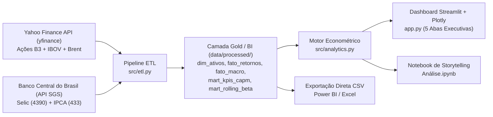

# 💧 Sanepar (`SAPR4`) & Setor de Saneamento na B3 — Risk, CAPM & BI Analytics


-006400)
[](https://share.streamlit.io/deploy?repository=msbrasil/Analise-SAPR-UFPR&branch=main&mainModule=app.py)

> **Case de Portfólio em Data Analytics & BI Financeiro** estruturado com pipeline ETL automatizado, camada dimensional pronta para BI, notebook executivo de storytelling e dashboard interativo em Streamlit.

### 🚀 Acesso Rápido ao Dashboard Interativo
- **Deploy / Publicação em 1 clique (Streamlit Community Cloud):** [](https://share.streamlit.io/deploy?repository=msbrasil/Analise-SAPR-UFPR&branch=main&mainModule=app.py)
- **Execução local:** `streamlit run app.py`
- **Notebook completo de storytelling:** [Análise.ipynb](Análise.ipynb)

---

## 🎯 Resumo Executivo (PT-BR)

Este projeto analisa o perfil de risco sistemático, geração de valor (Alpha de Jensen) e potencial de diversificação da **Sanepar (`SAPR4` e `SAPR11`)** frente ao mercado brasileiro (**Ibovespa**) e a pares do setor divididos em dois subsetores estratégicos:
- **Saneamento Básico (Água e Esgoto):** `SAPR4`, `SAPR11`, `SBSP3` (Sabesp), `CSMG3` (Copasa) e `CASN4` (Casan — sinalizada por governança devido à baixa liquidez).
- **Gestão Ambiental / Resíduos:** `AMBP3` (Ambipar) e `ORVR3` (Orizon).

### Principais Insights de Negócio (Ago/2019 – Out/2026 | 87 meses fechados)
1. **Perfil Defensivo Confirmado ($\beta < 1$):** A `SAPR4` apresentou **Beta = `0,741`** na janela analisada, mantendo menor sensibilidade ao Ibovespa do que Sabesp (`0,995`) e Copasa (`0,986`).
2. **Mais de 60% do Risco é Diversificável:** Pela decomposição de variância do CAPM, apenas **`38,3%`** ($R^2$) do risco da `SAPR4` é sistemático (de mercado); os outros **`61,7%`** ($1 - R^2$) representam risco idiossincrático que pode ser reduzido combinando o ativo em carteira.
3. **Saneamento vs. Resíduos (Tese de Subsetor):** Enquanto estatais de saneamento operam com *Betas* entre `0,74` e `1,00` e *drawdowns* na faixa de `-39%` a `-44%`, o subsetor privado de gestão ambiental apresenta perfis extremos — `ORVR3` com forte geração de Sharpe (`0,41`) e menor *drawdown* (`-24,8%`), em contraste com `AMBP3` (Beta `1,22`, *drawdown* de `-99,3%`).
4. **Resiliência em Choques Macro (Pandemia & Petróleo):** A análise empírica via Beta Móvel e correlação com **Petróleo Brent (`BZ=F`)** e **IPCA** mostra que a correlação direta da Sanepar com o petróleo é estatisticamente insignificante; em choques de commodities, o peso das exportadoras no Ibovespa tende a desconectar temporariamente o Beta das *utilities* domésticas.

---

## 🌐 Executive Summary (English)

This project is an end-to-end **Financial Data Analytics & BI solution** analyzing Brazil's sanitation and environmental services sector (**Sanepar `SAPR4` / `SAPR11`**, **Sabesp `SBSP3`**, **Copasa `CSMG3`**, **Ambipar `AMBP3`**, **Orizon `ORVR3`**) benchmarked against **Ibovespa**, **Brent Crude**, and **Central Bank of Brazil official rates (Selic & IPCA)**.

- **Data Engineering & BI Modeling:** Automated Python ETL (`src/etl.py`) extracting market data via `yfinance` and official macro time series via the **Central Bank of Brazil SGS API**, persisting clean dimensional tables (`dim_ativos`, `fato_precos_mensais`, `fato_retornos_mensais`, `fato_macro_mensal`, `mart_kpis_capm`, `mart_rolling_beta`).
- **Econometric Rigor & Risk Analytics:** OLS CAPM estimation, Jensen's Alpha, variance decomposition ($R^2$ vs. $1 - R^2$), liquidity/IPO data quality governance (`CASN4` exclusion; no artificial backward-fill prior to `AMBP3`/`ORVR3` IPOs), Sharpe, Sortino, Max Drawdown, Rolling Beta, and Markowitz Efficient Frontier optimization.
- **Interactive Delivery:** A 5-tab **Streamlit + Plotly Executive Dashboard** (`app.py`) with dynamic timeframe filters, risk-free rate controls, and a live portfolio diversification simulator, alongside a fully executed storytelling notebook (`Análise.ipynb`).

---

## 🏗️ Arquitetura de Dados (ETL & Camada BI)



---

## 📂 Estrutura do Repositório

```text
├── app.py                        # Dashboard interativo Streamlit (5 abas executivas + simulador)
├── Análise.ipynb                 # Notebook executivo de storytelling (executado com gráficos e análises)
├── requirements.txt              # Dependências Python do projeto
├── src/
│   ├── config.py                 # Metadados de ativos, códigos SGS BCB e marcos históricos
│   ├── etl.py                    # Pipeline ETL (yfinance + API BCB) e geração dos CSVs em data/processed/
│   ├── analytics.py              # Motor CAPM/OLS, Sharpe, Sortino, Drawdown, Rolling Beta e Markowitz
│   └── charts.py                 # Biblioteca de gráficos executivos em Plotly
└── data/
    └── processed/                # Tabelas dimensionais e Data Marts prontos para BI (CSVs versionados)
```

---

## 🚀 Como Executar Localmente

1. **Clonar o repositório e instalar as dependências:**
   ```bash
   pip install -r requirements.txt
   ```

2. **(Opcional) Atualizar a base de dados via API (B3 + Banco Central):**
   ```bash
   python -m src.etl
   ```
   *(Os dados já vêm pré-processados em `data/processed/` para carregamento instantâneo).*

3. **Abrir o Dashboard Interativo em Streamlit:**
   ```bash
   streamlit run app.py
   ```
